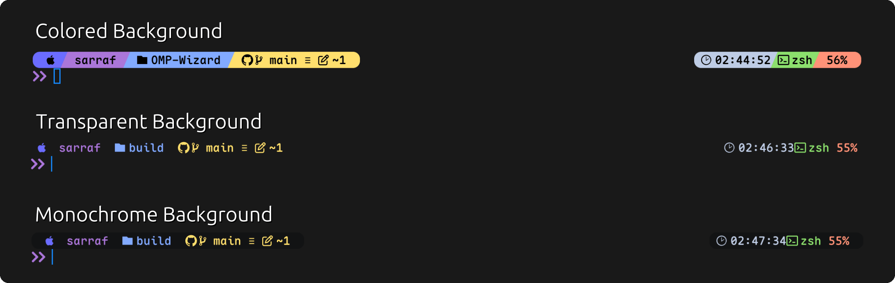
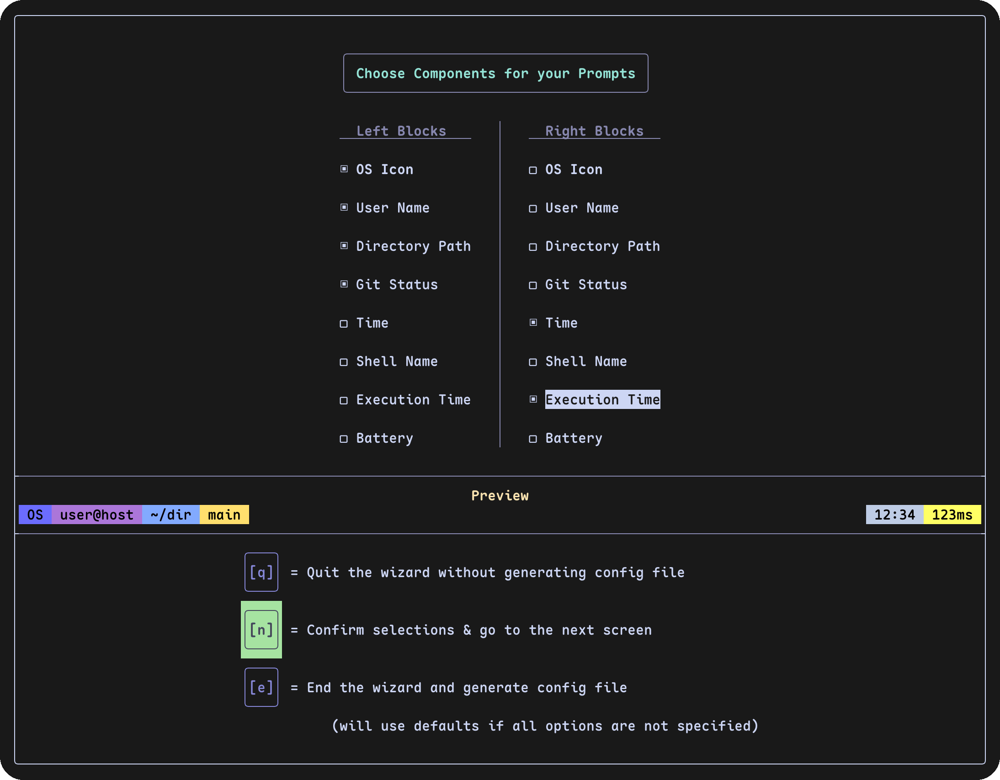
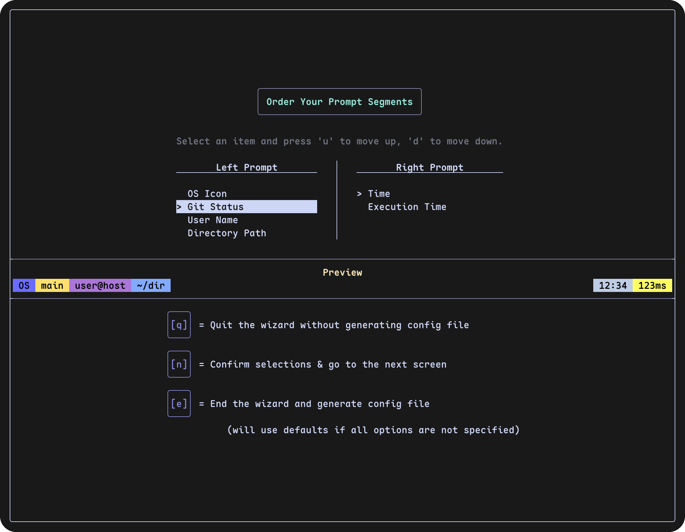
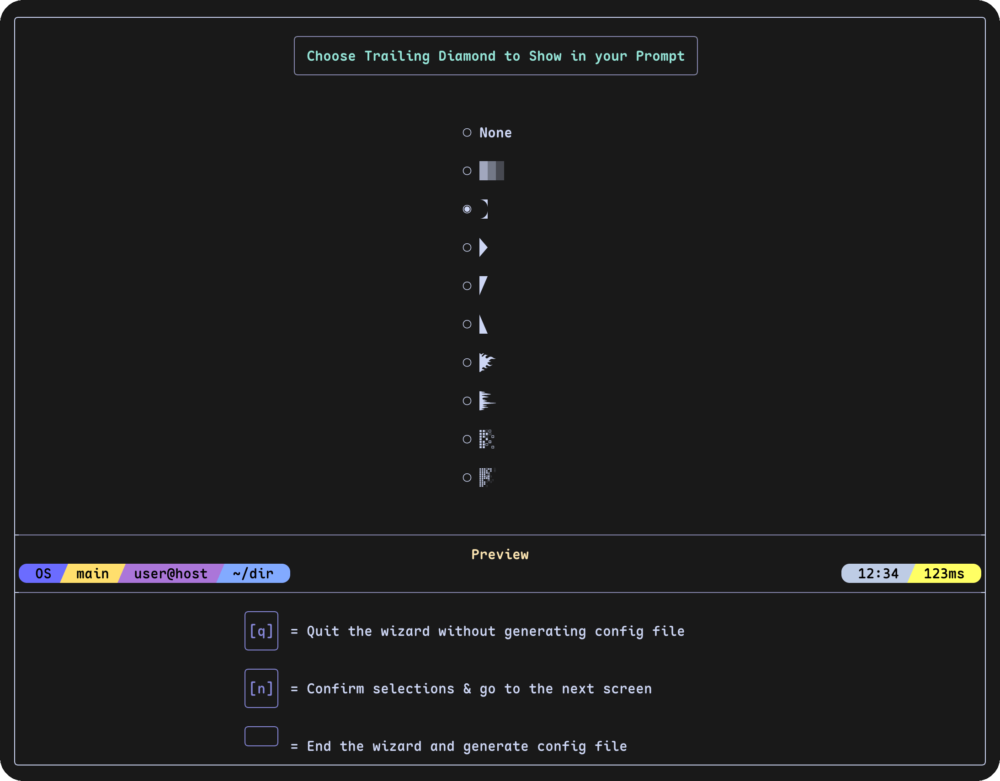
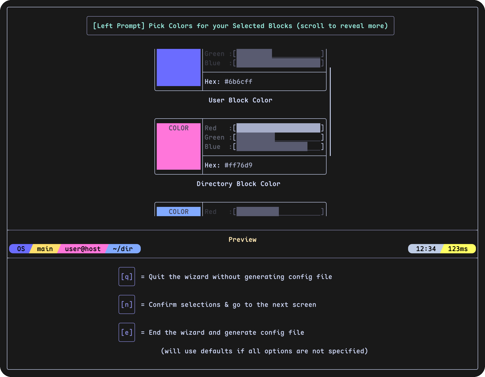

  

# OMP Wizard

A visual wizard to help users set up and customize their [Oh-My-Posh](https://github.com/JanDeDobbeleer/oh-my-posh) prompts.

  <video
    src=""
    autoplay loop muted playsinline alt="demo GIF" width="90%"></video>

  

  
  

  
  

# Getting Started

### Mac & Linux

1. Download the binary for your system (Mac/Windows/Linux) from the [Releases](https://github.com/SARRAF-5757/OMP-Wizard/releases) page
2. Open your terminal app and navigate (cd) to the directory where you downloaded the file (ex. Downloads)
3. Run the wizard with `./[os]-omp-wizard` (ex: `./mac-omp-wizard`)
   [Note: Check [Troubleshooting](#troubleshooting) if mac blocks the command]
4. Follow on-screen directions
5. On completion, the wizard will generate the theme file- `generated-theme.omp.json` and add it to your shell config
6. Restart your shell (ex. `source ~/.bashrc`) and enjoy :)

### Windows

1. Double click the downloaded file or run it by `.\win-omp-wizard.exe` in the terminal
   [Note: Check [Troubleshooting](#troubleshooting) if facing trouble opening the executable]
2. Follow the on-screen directions
3. On completion, the wizard will generate the theme file- `generated-theme.omp.json` and add it to your shell config
4. Restart your shell

_Pro Tip:_ The wizard generates the file in the directory you run it from. If you keep the wizard and the generated JSON file in a permanent location, you can re-run the wizard later to overwrite it, and your shell will update automatically upon restart!

# Feature Checklist

- [x] Left prompt customization
  - [x] User
  - [x] Directory Path
  - [x] Git Status
  - [ ] More blocks coming!
- [x] Right prompt customization
  - [x] Time
  - [x] Shell
  - [ ] Dynamic Tooling blocks
  - [ ] More coming
- [x] Three color modes (full/text/monochrome)
- [x] Color Picker
  - [x] Manual HEX entry
- [x] Transient Prompt support
  - [ ] Transient Prompt customization
- [x] Tab title customization
- [x] Live render of prompt's current customization progress
- [ ] Agnoster support for path block
- [ ] Icon-less mode
- [x] Advanced Mode
- [x] Platform support
  - [x] Apple Silicon Mac
  - [x] Intel Mac
  - [x] Windows
  - [x] Linux
- [x] Unified and streamlined setup process for all platforms
- [ ] More customization!

## Suggestions and Feature Requests

This project is just two friends building something they needed, so it's bound to get heavily opinionated. However, we want to make it useful for everyone. So, if you have ideas for features, polish, or changes, please drop a note in [Discussions](https://github.com/SARRAF-5757/OMP-Wizard/discussions)

## Troubleshooting

- If you don't see some of the diamonds or some parts of the TUI look weird, make sure you have a [nerd font](https://www.nerdfonts.com/font-downloads) installed
- On Windows, if Microsoft Defender blocks you, just click on `More Info` and then `Run Anyway`. You can check the source code, promise I'm not distributing malware :)
- On MacOS, you might see a pop-up saying Apple could not verify if the software contains malware. Open System Settings->Privacy & Security. Scroll down until you see `“mac-omp-wizard” was blocked to protect your Mac.` Click on open anyway and repeat step 4 again.

## References

- TUI library used - [FTXUI](https://github.com/ArthurSonzogni/FTXUI) | [Docs](https://arthursonzogni.github.io/FTXUI/index.html)
- Library used to generate JSON - [nlohmann/json](https://github.com/nlohmann/json) | [Docs](https://json.nlohmann.me/api/basic_json/)
- Find [Diamonds](https://www.nerdfonts.com/cheat-sheet)
  - [Powerline symbols](https://github.com/ryanoasis/powerline-extra-symbols/raw/master/img/fontforge.png)
  - To check what a diamond looks like, run `print '\u[hex code for icon]'` in the terminal (`\uef4d` for example)
